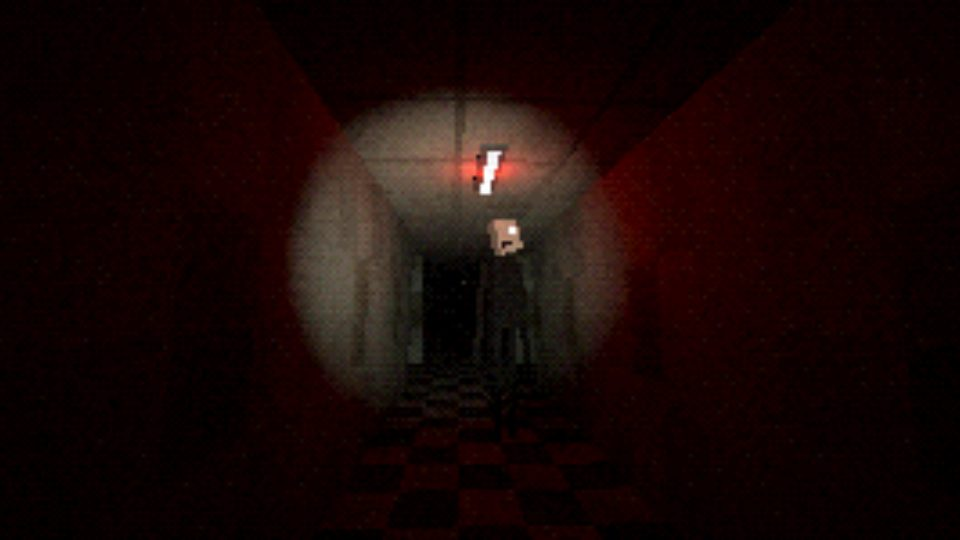

# Shiver

A platform for making and playing **multiplayer horror games**, in the browser or as a desktop app. Creators write games in JavaScript in an in-browser studio. Players join in one click with proximity voice chat, and **monsters can hear your real microphone**.

**Play it:** https://shiver.skelr.workers.dev
**Desktop app:** [Mac (Apple Silicon)](https://github.com/learningnihongo934-byte/Shiver/releases/latest/download/Shiver-0.1.0-mac-arm64.dmg) · [Mac (Intel)](https://github.com/learningnihongo934-byte/Shiver/releases/latest/download/Shiver-0.1.0-mac-x64.dmg) · [Windows](https://github.com/learningnihongo934-byte/Shiver/releases/latest/download/Shiver-0.1.0-win-x64.exe)



## What's in it

- **Play**: discover games, join public rooms, start private rooms with invite codes, like games and remix them.
- **Studio**: a Monaco code editor with Shiver API autocomplete and a live test window next to the code. Errors link to their line. You can test alone or with friends in a private draft room, then publish in one click.
- **Horror features**:
  - Mic loudness becomes in-game noise that AI monsters hunt.
  - Proximity voice is muffled through walls.
  - Walkie-talkie items carry voice across the map.
  - Monster players get a demon voice-changer and thermal vision.
  - Dead players become ghosts who flicker lights and whisper to the living.
- **Cutscenes and movies**: script camera moves, actors, dialogue, choices and title cards. A whole game can be a film, and the ● Rec button exports a `.webm` video with subtitles and sound.
- **Pixel art**:
  - Import [Pixeter](https://pixeter.app) projects, sprite sheets (Pixeter or Aseprite JSON) or images.
  - Imported art can be a camera-facing sprite (animated monsters included), a texture, a HUD image or a jumpscare.
  - There's also a built-in sprite editor with frames, animations and mirror drawing.
- **Engine** (three.js) with five render styles: `retro` (PS1), `vhs`, `hd`, `noir` and `pixel`. Cameras can be first person, third person or top-down. It also has physics, A* monster navigation, procedural textures and models, and fully synthesized sound effects and music.
- **Built-in games**:
  - *The Ward*: co-op stealth.
  - *Hide & Shriek*: one player is the monster.
  - *Fluorescent*: a procedural maze with a monster that only moves when nobody is looking.
  - *Graveyard Shift*: top-down pixel.
  - *The Last Shift*: a short film made in code.

## Run it

```bash
./build.sh            # installs deps, starts http://localhost:8781
./build.sh test       # syntax check + end-to-end smoke test (SHIVER_URL=... tests a live site)
./build.sh deploy     # deploy to Cloudflare Workers + Durable Objects
./build.sh desktop    # desktop app (Electron)
./build.sh package    # desktop installers: ./build.sh package mac|win
```

Requires Node 20+. Locally, data lives in `data/` (change it with `SHIVER_DATA`). A `Dockerfile` is included for any Node host. For players behind strict NATs, set `SHIVER_TURN_URL`, `SHIVER_TURN_USER` and `SHIVER_TURN_PASS`.

## How it works

```
server/      core.js (accounts, games, publishing, assets) + rooms.js (WebSocket relay), used by both:
             index.js     the Node server (local, Docker, desktop app)
cf/          worker.js    the Cloudflare Worker + Durable Object (SQLite storage)
web/         the platform website (vanilla JS, no build step), voice chat, sprite editor, Pixeter import
runtime/     the game engine, which runs inside a sandboxed iframe
templates/   built-in games, seeded on every server start
desktop/     Electron wrapper
tools/       smoke test, Cloudflare build
```

- **Nobody writes a server.** In each room one player is the *host*, and their browser runs the `.host.js` scripts. The server only relays messages. If the host leaves, the next player becomes host and the round restarts.
- **Scripts by file name:** `*.shared.js` runs on every player (build the level), `*.host.js` runs on the host (rules and monsters), and `*.client.js` runs on each player (HUD and effects). Entities spawned in shared scripts get deterministic ids, so the host can sync them without sending the whole map.
- **Sandboxing:** creator code runs in an `<iframe sandbox="allow-scripts allow-pointer-lock">` with an opaque origin and a CSP of `connect-src 'none'`. It cannot reach your account, the network or the microphone. The platform page owns the mic and voice chat and passes in only the *volume*, plus where each voice should sound from.
- **Voice:** each player's mic goes through an optional effect chain (demon, ghost or robot pitch shifting via an AudioWorklet), then out to every other player over WebRTC. Each listener mixes incoming voices using positions, wall counts and radio flags computed by the game, so `voice.mix()` lets creators invent their own voice rules.

The full scripting API is documented in the app at `/docs`.

The desktop builds are not code-signed. On macOS, right-click the app and choose Open the first time; on Windows, choose "More info" and then "Run anyway".

Made by **Virat Reddy Kaukuntla** ([@learningnihongo934-byte](https://github.com/learningnihongo934-byte))
